# Hướng dẫn cho nhân viên

Dành cho mọi nhân viên HS Holding dùng trợ lý Khởi Tâm trên Zalo. Quay lại [trang chính](README.md).

**Cách dùng chung:** mở Zalo, vào cuộc trò chuyện với **Khởi Tâm**, nhắn câu bình thường như nhắn cho một người trợ lý. Khởi Tâm trả lời sau khoảng 30 giây đến 2 phút.

Lưu ý: các lệnh bắt đầu bằng dấu `/` (như `/viec`) chỉ chủ tài khoản dùng được. Nhân viên cứ nhắn câu thường.

## Mục lục

- [Phần 1. Khách hàng](#phần-1-khách-hàng)
- [Phần 2. Lịch hẹn](#phần-2-lịch-hẹn)
- [Phần 3. Công việc](#phần-3-công-việc)
- [Phần 4. Khởi Tâm sẽ tự nhắc anh chị những gì](#phần-4-khởi-tâm-sẽ-tự-nhắc-anh-chị-những-gì)
- [Phần 5. Xem lại trên Ant CRM](#phần-5-xem-lại-trên-ant-crm)
- [Câu hỏi thường gặp](#câu-hỏi-thường-gặp)

---

## Phần 1. Khách hàng

### 1.1 Thêm khách mới vào CRM

Nhắn tên khách và số điện thoại.

> Thêm khách mới vào CRM giúp anh: Anh Minh, số điện thoại 0900000001

Khởi Tâm tạo hồ sơ, anh chị là người phụ trách, và gửi lại link hồ sơ.

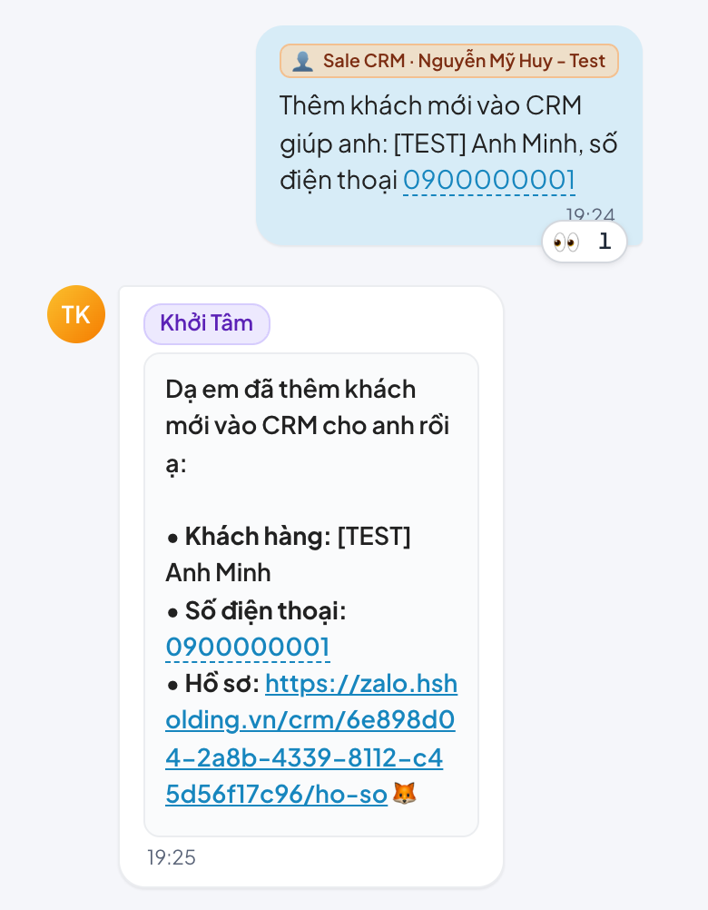

### 1.2 Ghi chú vào hồ sơ khách

> Ghi chú cho khách Anh Minh: khách quan tâm căn 2PN tầng cao, ngân sách khoảng 3 tỷ

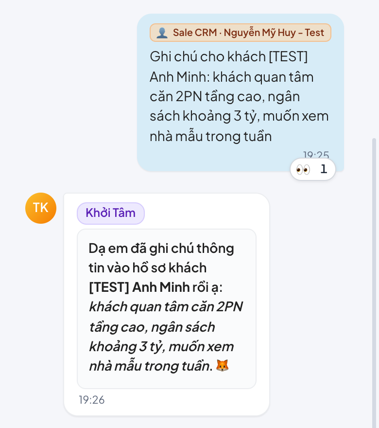

### 1.3 Xem khách mình đang phụ trách

> Khách CRM anh đang phụ trách có những ai?

Khởi Tâm tách rõ: khách anh chị phụ trách chính, và khách anh chị chăm cùng người khác.

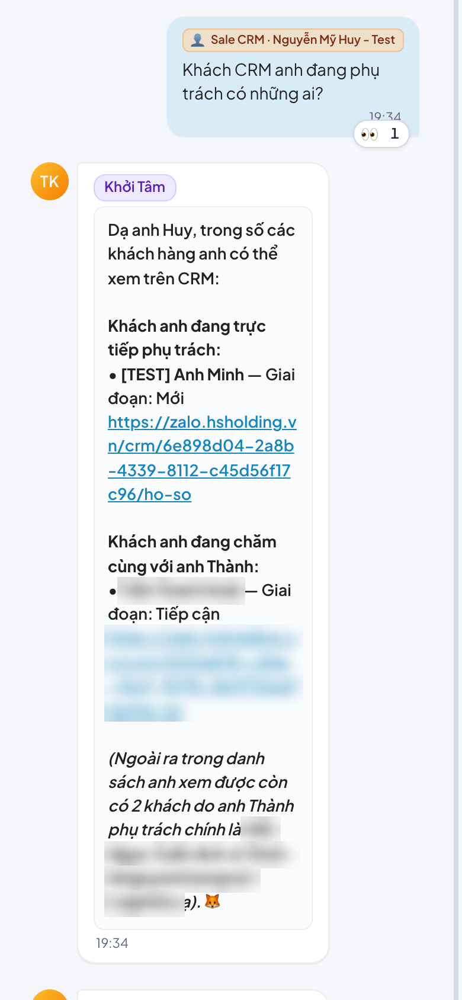

### 1.4 Đổi giai đoạn của khách

> Chuyển khách Anh Minh sang giai đoạn Tiếp cận

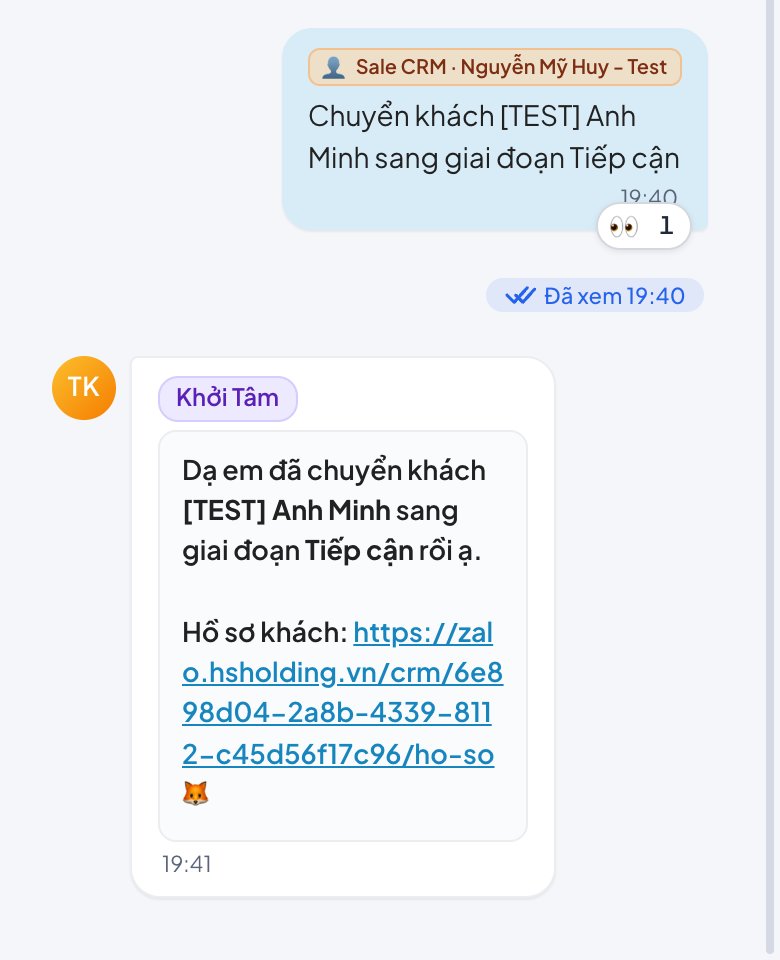

### 1.5 Khi cấp trên giao khách cho anh chị

Anh chị không cần làm gì. Khởi Tâm tự nhắn báo, kèm số điện thoại khách và link hồ sơ.

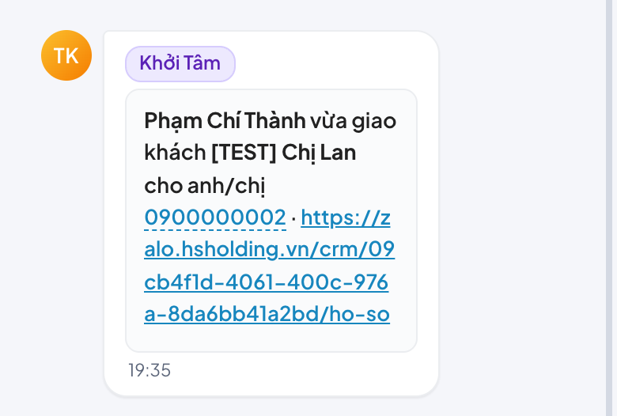

---

## Phần 2. Lịch hẹn

Dùng lịch hẹn cho mọi lần liên hệ khách có giờ cụ thể: gọi lại, hẹn gặp, dẫn xem nhà.

### 2.1 Đặt lịch hẹn

Nói rõ khách nào, lúc nào, làm gì.

> Đặt lịch hẹn với khách Anh Minh lúc 15h chiều mai, xem nhà mẫu tại văn phòng dự án

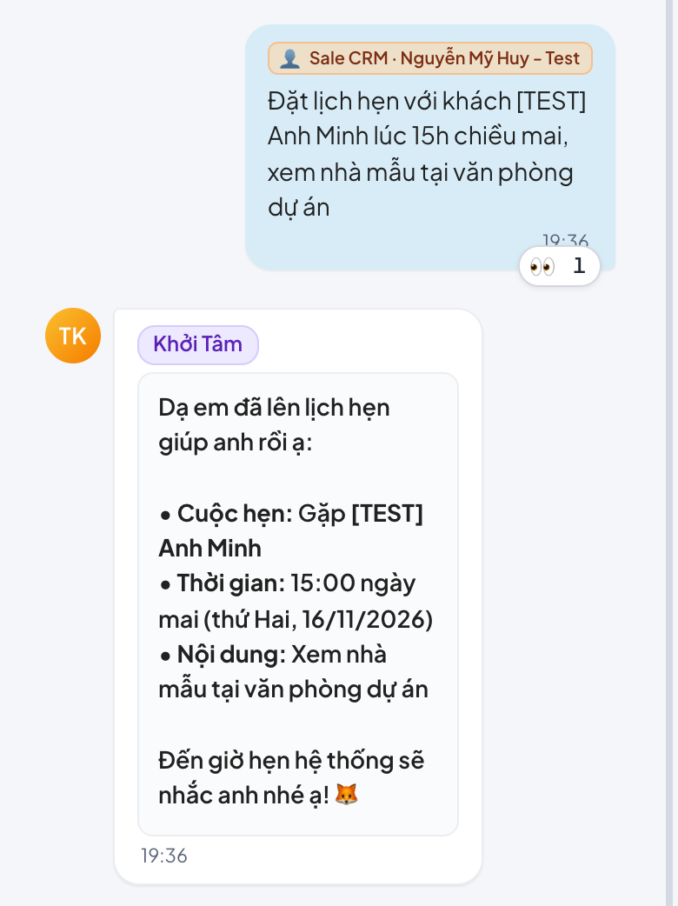

### 2.2 Dời lịch hẹn

> Dời lịch hẹn với Anh Minh sang 16h30 chiều mai giúp anh

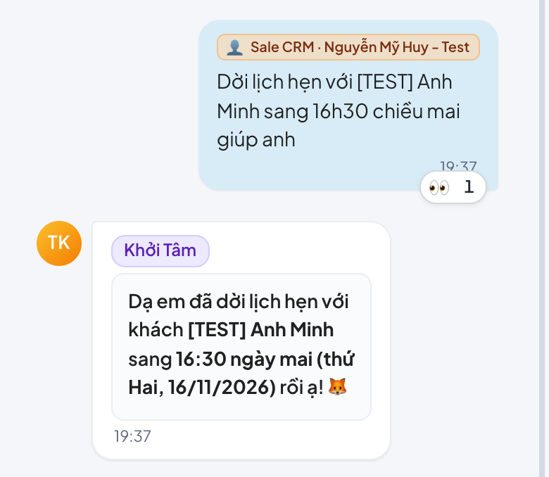

### 2.3 Xem lịch hẹn sắp tới

> Tuần này anh có những lịch hẹn nào?

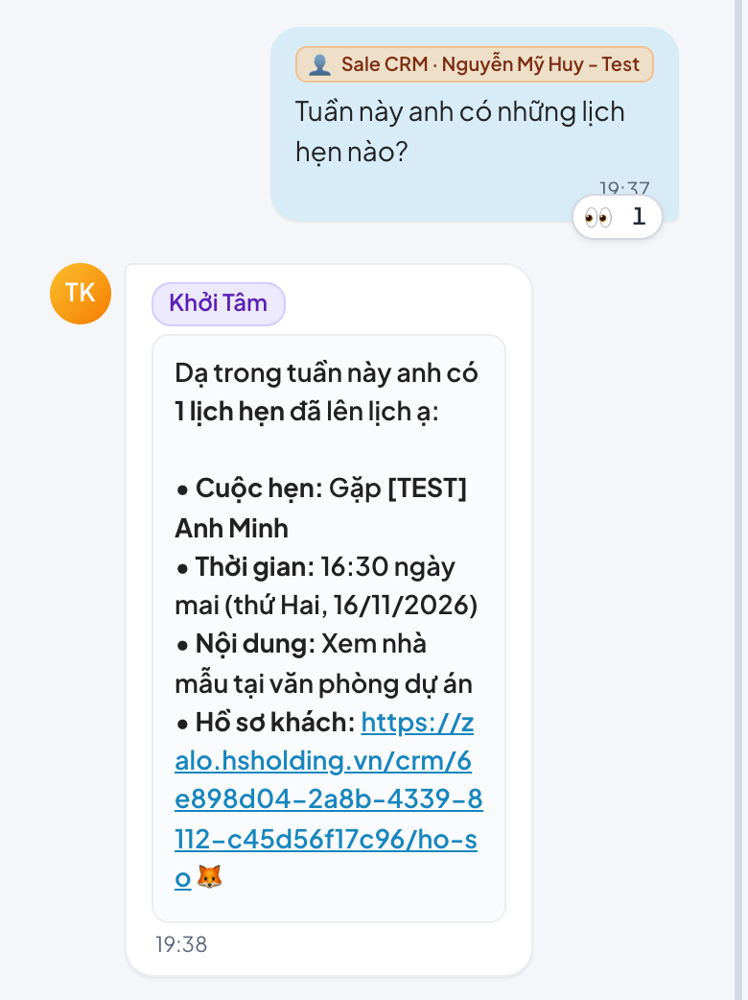

### 2.4 Huỷ lịch hẹn

Nói kèm lý do. Khởi Tâm ghi lý do vào hồ sơ khách.

> Huỷ lịch gọi Chị Lan thứ Tư nhé, chị ấy báo bận

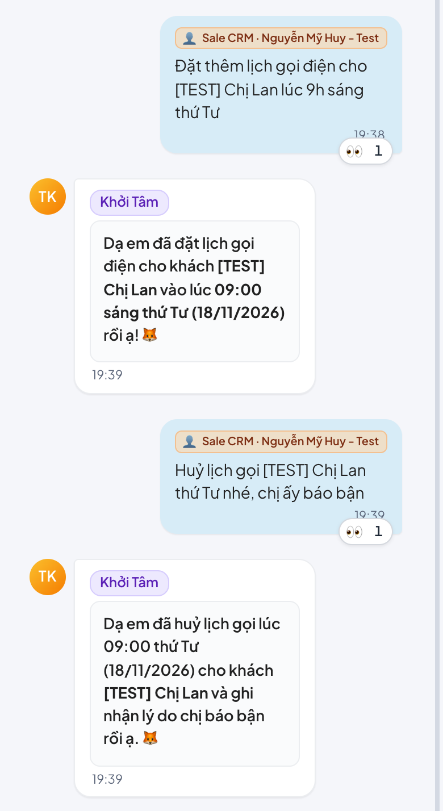

### 2.5 Báo đã gặp xong và kể lại buổi gặp

Sau buổi gặp, nhắn một câu vừa báo xong vừa kể kết quả. Khởi Tâm đánh dấu lịch đã xong và lưu lời kể vào hồ sơ khách.

> Lịch hẹn với Anh Minh anh gặp xong rồi. Khách ưng căn 2PN tầng 15, hẹn cuối tuần dẫn vợ qua xem lại

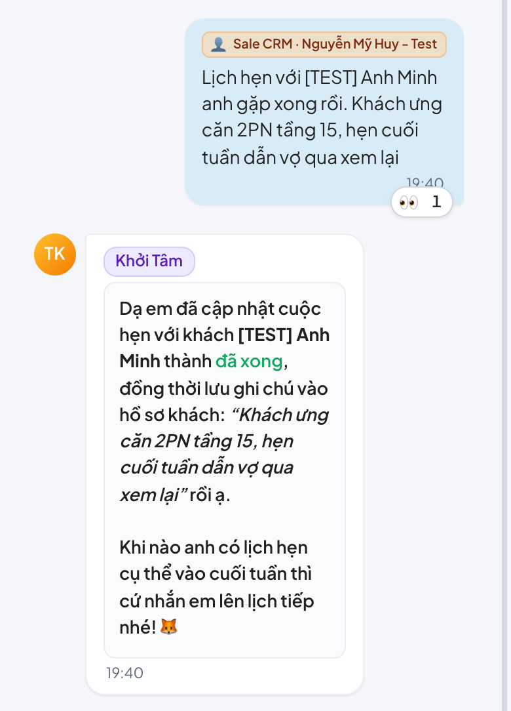

Ngoài cách nhắn Khởi Tâm, sau giờ hẹn Ant CRM cũng gửi cho anh chị một tin Zalo có link **Hoàn thành** và **Huỷ**. Bấm link nào cũng được. Sau đó Khởi Tâm sẽ hỏi thêm buổi gặp thế nào để ghi vào hồ sơ.

---

## Phần 3. Công việc

### 3.1 Xem việc của mình

> Hôm nay anh có việc gì cần làm không em?

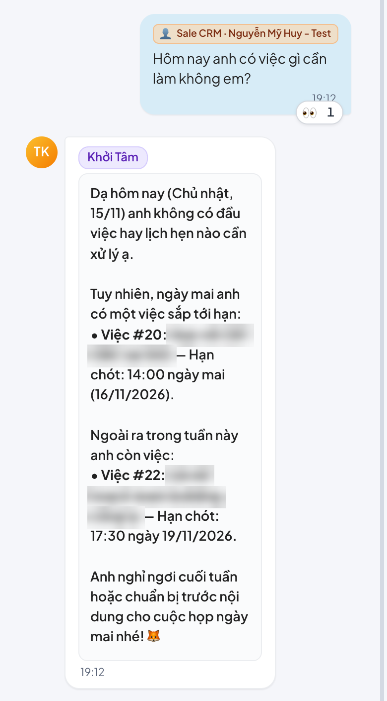

### 3.2 Thêm một việc

Nói tên việc và hạn. Mỗi việc có một **số việc** (ví dụ #23) để gọi cho nhanh về sau.

> Thêm giúp anh việc: Soạn báo giá căn 2PN cho khách Minh, hạn 17h chiều mai

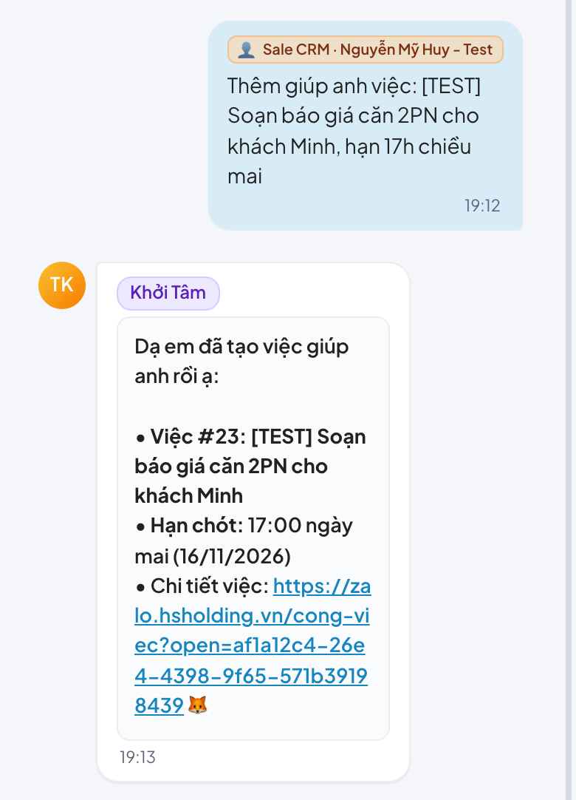

### 3.3 Thêm nhiều việc một lúc

Liệt kê các việc trong một tin. Khởi Tâm tạo từng việc riêng.

> Thêm luôn 3 việc cho ngày mai: Gọi lại nhà thầu xác nhận lịch bàn giao; Chụp ảnh căn mẫu tầng 12; Nộp báo cáo tuần

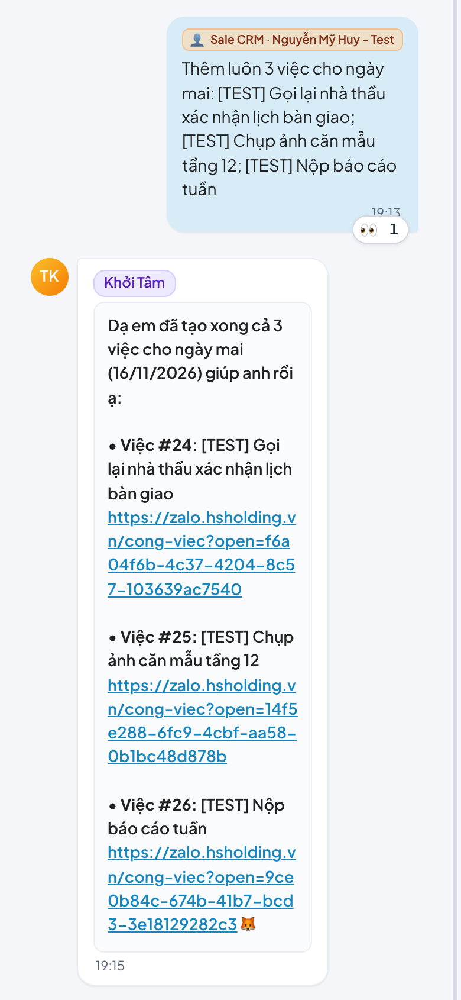

### 3.4 Bắt đầu làm một việc (bật đồng hồ)

> Anh bắt đầu làm việc số 23 nhé

Khởi Tâm bật đồng hồ tính giờ cho việc đó. Mỗi người chỉ chạy **một việc một lúc**: bắt đầu việc khác thì việc đang chạy tự dừng và được ghi giờ.

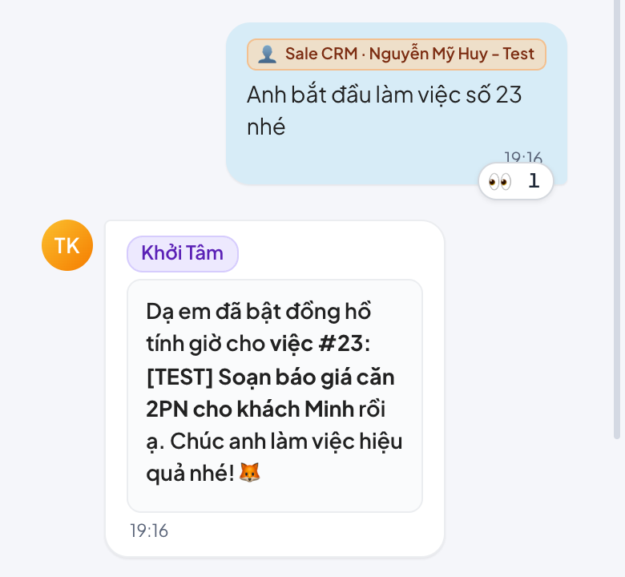

### 3.5 Ghi chú tiến độ

> Ghi chú cho việc 23: đã có bảng giá từ chủ đầu tư, đang lên file báo giá

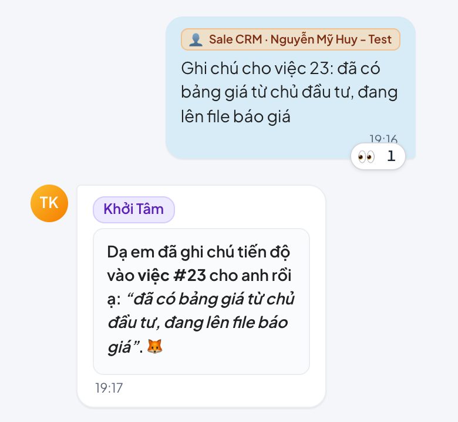

### 3.6 Dừng đồng hồ

> Anh dừng việc 23

Số phút đã làm được cộng vào việc. Nếu quên dừng, hệ thống tự dừng lúc 23:59.

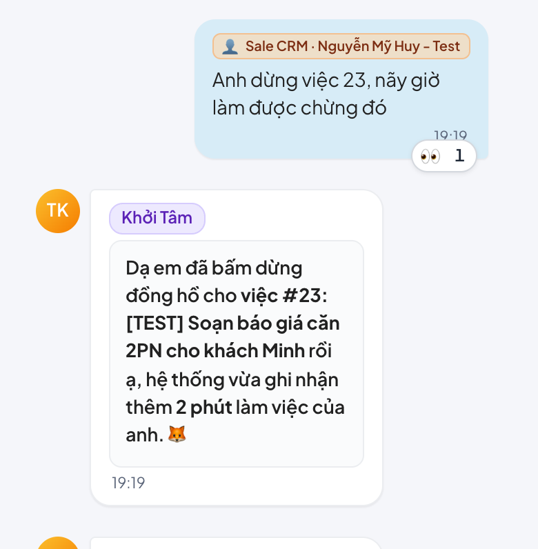

### 3.7 Báo xong việc

> Việc số 24 anh làm xong rồi

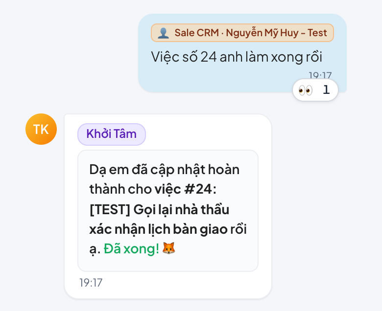

### 3.8 Dời hạn

> Dời việc số 25 sang thứ Tư tuần này giúp anh

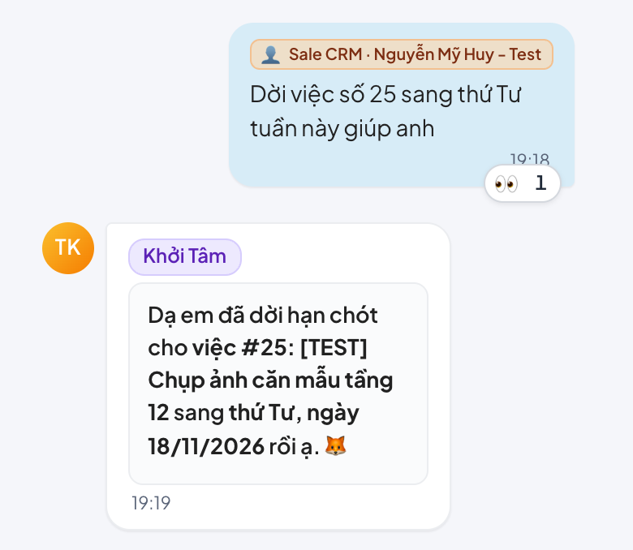

Lưu ý: một việc bị trễ thì chỉ nên dời một lần. Việc đã dời mà lại trễ, hoặc trễ từ 2 ngày, Khởi Tâm sẽ yêu cầu anh chị chọn rõ: làm ngay, hẹn một ngày cụ thể, hoặc bỏ.

### 3.9 Khi cấp trên giao việc cho anh chị

Khởi Tâm tự nhắn báo, kèm hạn và link việc. Làm xong thì báo như mục 3.7. Người giao sẽ nhận được tin "đã hoàn thành".

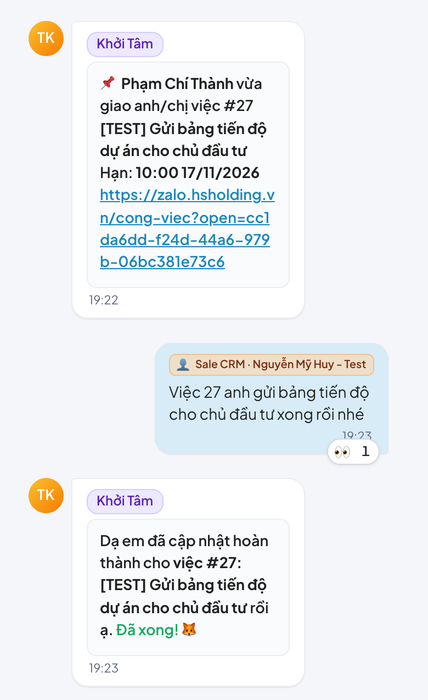

Với việc được giao, anh chị sửa được nội dung, dời hạn, báo xong. Anh chị **không xoá được** việc đó; chỉ người giao xoá được.

### 3.10 Nhân viên không giao việc cho người khác

Nhân viên chỉ tạo việc cho chính mình. Nếu cần nhờ cấp trên, Khởi Tâm đề nghị chuyển lời.

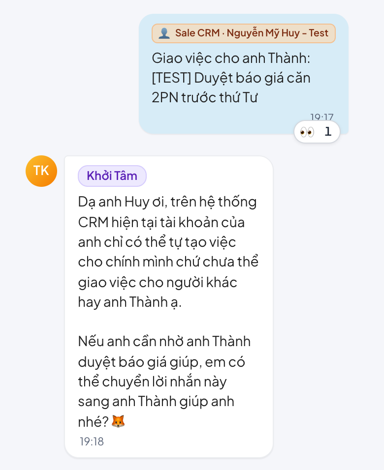

---

## Phần 4. Khởi Tâm sẽ tự nhắc anh chị những gì

| Lúc | Khởi Tâm nhắc gì |
|---|---|
| Sau 9:00 sáng ngày làm việc | Anh chị chưa xếp việc nào cho hôm nay thì được nhắc lên việc |
| Trước hạn 30 phút | Việc có giờ sắp tới hạn |
| 14:00 | Các việc ưu tiên cao chưa xong |
| 17:30 | Việc còn tồn trong ngày: xong chưa, dời sang mai, hay bỏ |
| Sáng hôm sau | Hôm trước có việc mà không xong việc nào thì Khởi Tâm hỏi thăm riêng |
| Đồng hồ chạy quá 4 tiếng | Hỏi "còn đang làm không?" |
| Trước và sau giờ hẹn khách | Nhắc lịch hẹn, hỏi kết quả buổi gặp |

Hai giới hạn nên nhớ:

- **Tồn từ 10 việc trở lên** của các ngày trước thì anh chị phải dọn bớt (làm xong, dời hạn, hoặc bỏ) rồi mới tự thêm việc mới được. Việc cấp trên giao vẫn nhận bình thường.
- **Hai ngày liên tiếp có việc mà không xong việc nào** thì Khởi Tâm báo cho trưởng phòng.

---

## Phần 5. Xem lại trên Ant CRM

Mở `zalo.hsholding.vn` trên điện thoại, đăng nhập bằng tài khoản của anh chị.

### Màn Công việc

Vào **Menu → Công việc**. Việc Khởi Tâm tạo hiện ngay ở đây.

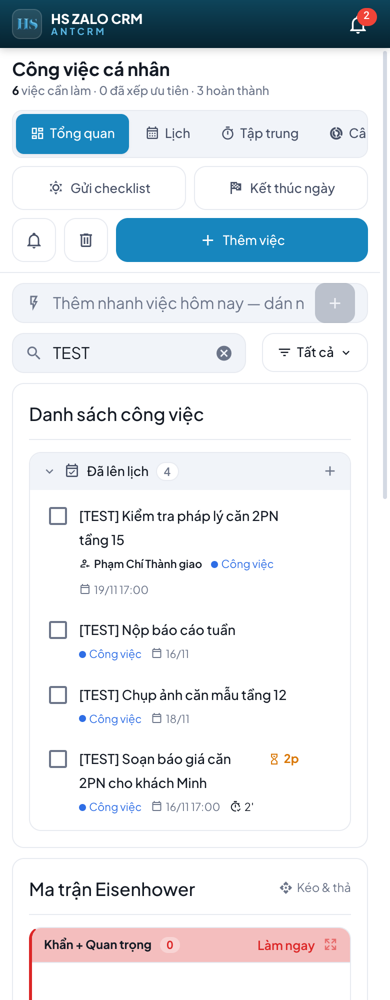

- Ô **Thêm nhanh**: gõ tên việc rồi bấm dấu cộng. Không ghi ngày thì việc tính cho hôm nay. Dán cả danh sách nhiều dòng thì mỗi dòng thành một việc.
- Tick ô vuông trước tên việc để báo xong.
- Bấm vào một việc để mở chi tiết.

### Chi tiết một việc

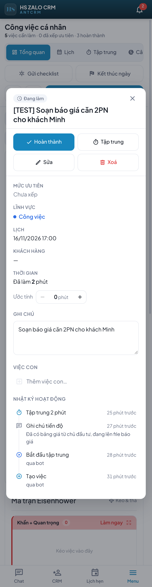

Ở đây có nút Hoàn thành, Tập trung (bật đồng hồ), Sửa, phần ghi chú, việc con, và nhật ký hoạt động. Dòng nào do Khởi Tâm ghi sẽ có chữ "qua bot".

### Màn Lịch hẹn

Bấm **Lịch hẹn** ở thanh dưới cùng.

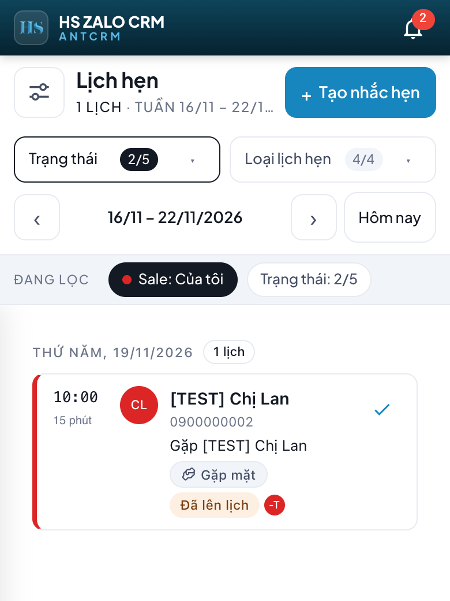

### Hồ sơ khách

Bấm link hồ sơ trong tin của Khởi Tâm, hoặc vào **CRM** rồi chọn khách.

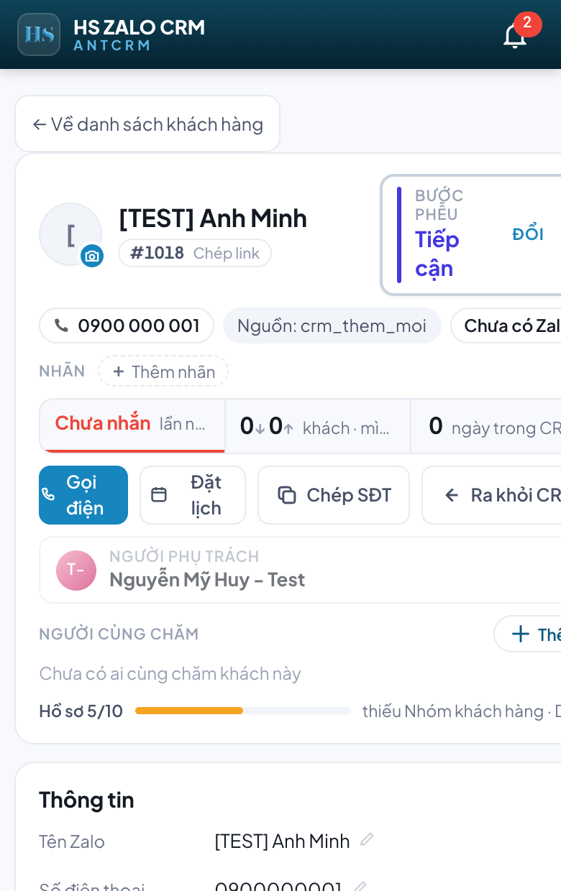

---

## Câu hỏi thường gặp

**Khởi Tâm trả lời chậm, có sao không?**
Bình thường. Việc đơn giản mất khoảng 30 giây, việc nhiều bước (như thêm 3 việc một lúc) có thể mất 2 phút. Đừng nhắn lại cùng câu trong lúc chờ.

**Tôi nhắn sai, muốn sửa thì làm sao?**
Nhắn tiếp câu sửa, kèm số việc cho chắc. Ví dụ: "Việc 23 đổi hạn thành 9h sáng thứ Ba".

**Tôi có xoá được việc không?**
Việc tự tạo thì xoá được, nhắn "Xoá việc số 26". Khởi Tâm hỏi lại một lần, anh chị trả lời "Đồng ý" thì mới xoá. Việc bị xoá nằm trong thùng rác trên Ant CRM, còn khôi phục được. Việc cấp trên giao thì chỉ người giao xoá được.

**Vì sao Khởi Tâm nói không thấy khách?**
Anh chị chỉ thấy khách mình phụ trách hoặc chăm cùng. Khách của người khác thì Khởi Tâm không cho xem. Nếu khách đã được đưa ra khỏi CRM, Khởi Tâm sẽ nói rõ ngày và lý do, rồi hỏi có đưa lại không.

**Việc riêng tư của tôi cấp trên có thấy không?**
Việc thuộc lĩnh vực cá nhân (sức khoẻ, tài chính, học tập…) do anh chị tự tạo thì Khởi Tâm không kể với cấp trên. Việc lĩnh vực Công việc và việc được giao thì cấp trên xem được.
