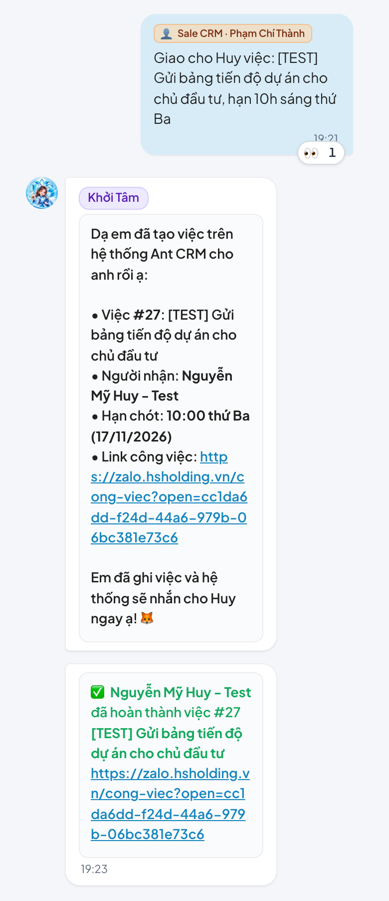
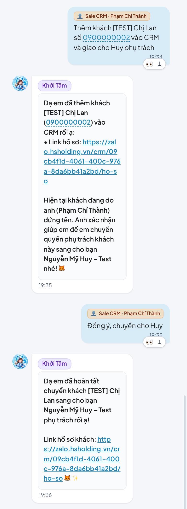
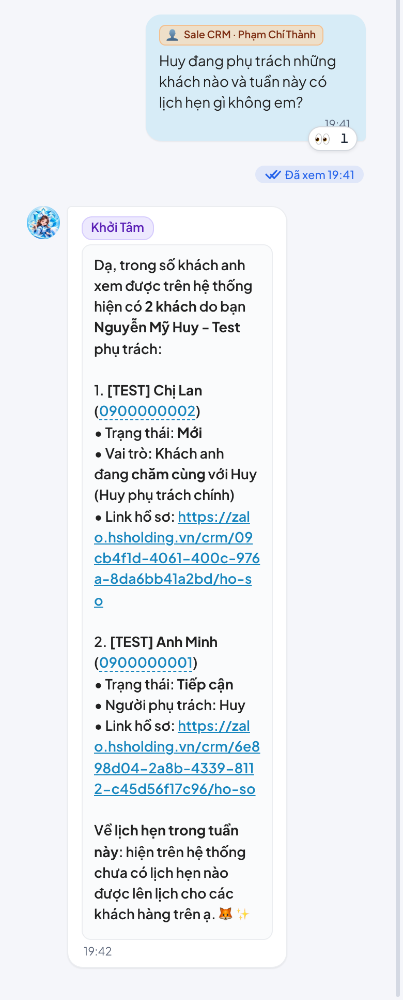
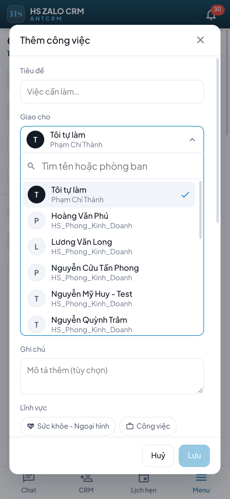
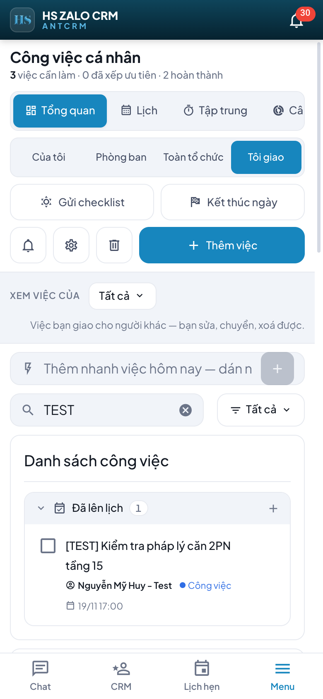

# Hướng dẫn cho quản lý (trưởng phòng, phó phòng)

Dành cho trưởng phòng và phó phòng. Quay lại [trang chính](README.md).

Quản lý làm được mọi thứ trong [bản nhân viên](01-nhan-vien.md). Bản này chỉ nói phần thêm của quản lý: **giao việc, giao khách, theo dõi phòng**.

**Phạm vi của quản lý:** người trong phòng mình và các phòng con. Giao việc hoặc xem việc của người ngoài phòng thì Khởi Tâm từ chối.

Ảnh chat trong bản này chụp từ tài khoản của anh Thành (chủ tổ chức). Với trưởng phòng, câu nhắn và câu trả lời giống hệt, chỉ khác là phạm vi dừng ở phòng mình.

## Mục lục

- [Phần 1. Giao việc](#phần-1-giao-việc)
- [Phần 2. Giao khách](#phần-2-giao-khách)
- [Phần 3. Theo dõi phòng](#phần-3-theo-dõi-phòng)
- [Phần 4. Khởi Tâm sẽ tự báo cho anh chị những gì](#phần-4-khởi-tâm-sẽ-tự-báo-cho-anh-chị-những-gì)
- [Phần 5. Giao việc trên Ant CRM](#phần-5-giao-việc-trên-ant-crm)

---

## Phần 1. Giao việc

### 1.1 Giao một việc cho nhân viên

Nói rõ giao cho ai, việc gì, hạn khi nào.

> Giao cho Huy việc: Gửi bảng tiến độ dự án cho chủ đầu tư, hạn 10h sáng thứ Ba

Khởi Tâm tạo việc, trả lại số việc và link, rồi tự nhắn cho người nhận. Khi người đó làm xong, anh chị nhận được tin báo "đã hoàn thành".

Mẹo:

- Muốn nhấn mạnh thì nói thêm "việc này quan trọng" hoặc "việc này gấp". Khởi Tâm sẽ đánh dấu mức ưu tiên, và việc đó được nhắc trước.
- Giao cùng một việc cho nhiều người: Khởi Tâm tạo cho mỗi người một việc riêng, ai xong người đó tự báo.

### 1.2 Người nhận làm được gì với việc anh chị giao

| Người nhận | Làm được |
|---|---|
| Sửa nội dung, dời hạn | Được. Anh chị được báo khi họ đổi. |
| Ghi chú tiến độ, báo xong | Được. Anh chị được báo khi xong. |
| Xoá việc | Không. Chỉ người giao xoá được. |
| Chuyển việc cho người khác | Không. Chỉ người giao chuyển được. |

### 1.3 Chuyển việc sang người khác, hoặc xoá việc đã giao

> Chuyển việc số 27 sang cho Lan

> Xoá việc số 27

Hai thao tác này Khởi Tâm sẽ hỏi lại một lần rồi mới làm. Việc bị xoá nằm trong thùng rác trên Ant CRM, còn khôi phục được.

---

## Phần 2. Giao khách

### 2.1 Thêm khách rồi giao cho nhân viên

> Thêm khách Chị Lan số 0900000002 vào CRM và giao cho Huy phụ trách

Khởi Tâm làm hai bước: thêm khách trước, rồi **hỏi anh chị xác nhận** trước khi chuyển người phụ trách. Anh chị trả lời "Đồng ý" thì Khởi Tâm chuyển, và tự nhắn cho nhân viên.

### 2.2 Chuyển một khách có sẵn sang người khác

> Chuyển khách Anh Minh sang cho Lan phụ trách

Cũng cần anh chị xác nhận ở tin kế tiếp.

### 2.3 Xem khách của nhân viên

> Huy đang phụ trách những khách nào và tuần này có lịch hẹn gì không em?

Lưu ý khi đọc con số: Khởi Tâm trả lời theo **khách anh chị được xem**, không phải toàn bộ khách của công ty.

---

## Phần 3. Theo dõi phòng

### 3.1 Hỏi tình hình việc của phòng

> Phòng em hôm nay việc tới đâu rồi?

Khởi Tâm tóm tắt: bao nhiêu việc xong, bao nhiêu việc trễ, việc nào cần chú ý ngày mai, ai đang phụ trách.

### 3.2 Hỏi việc của một người

> Huy tuần này còn những việc gì chưa xong?

### 3.3 Những gì quản lý không thấy

Việc **cá nhân** của nhân viên (sức khoẻ, tài chính, học tập… do họ tự tạo) không hiện với quản lý. Quản lý chỉ thấy việc lĩnh vực Công việc và việc được giao.

---

## Phần 4. Khởi Tâm sẽ tự báo cho anh chị những gì

| Khi nào | Khởi Tâm báo |
|---|---|
| Nhân viên làm xong việc anh chị giao | "X đã hoàn thành việc #…" |
| Nhân viên dời hạn hoặc sửa việc anh chị giao | Việc nào, đổi từ đâu sang đâu |
| Việc anh chị giao trễ quá 1 ngày | Báo một lần cho mỗi việc |
| Nhân viên tồn từ 10 việc trở lên | Báo một lần |
| Nhân viên 2 ngày liên tiếp có việc mà không xong việc nào | Báo một lần |
| 8:30 sáng thứ Hai | Báo cáo tuần của phòng |

Báo cáo đi theo sơ đồ phòng ban trong Ant CRM: nhân viên báo lên trưởng phòng; trưởng phòng báo lên trưởng phòng cấp trên, rồi tới chủ tổ chức. Phòng chưa có trưởng thì báo lên cấp trên kế tiếp.

---

## Phần 5. Giao việc trên Ant CRM

Ngoài nhắn Khởi Tâm, anh chị giao việc thẳng trên Ant CRM cũng được. Người nhận vẫn được Khởi Tâm nhắn báo.

### Giao việc khi thêm hoặc sửa việc

Vào **Menu → Công việc → Thêm việc**. Ô **Giao cho** hiện danh sách người anh chị giao được, có ô tìm theo tên hoặc phòng ban. Để "Tôi tự làm" nếu là việc của mình.

### Xem các việc mình đã giao

Trên màn Công việc, bấm **Tôi giao**. Bấm **Phòng ban** để xem việc của cả phòng.

Ở mục "Tôi giao", anh chị sửa, chuyển, xoá được các việc này.
