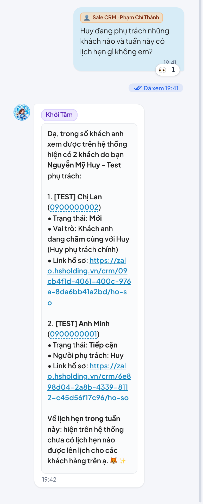
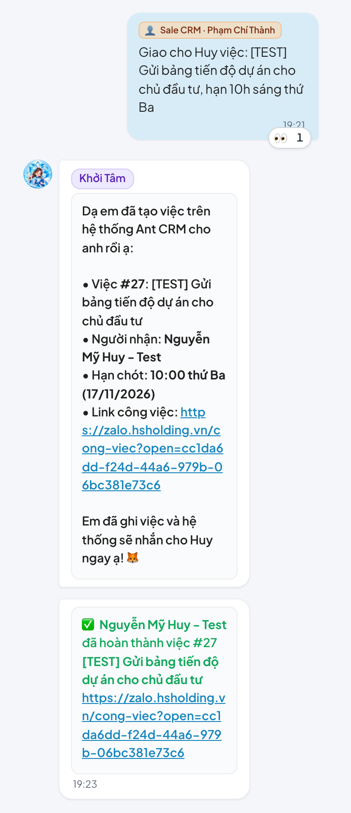
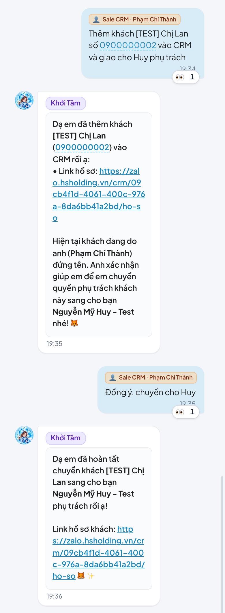
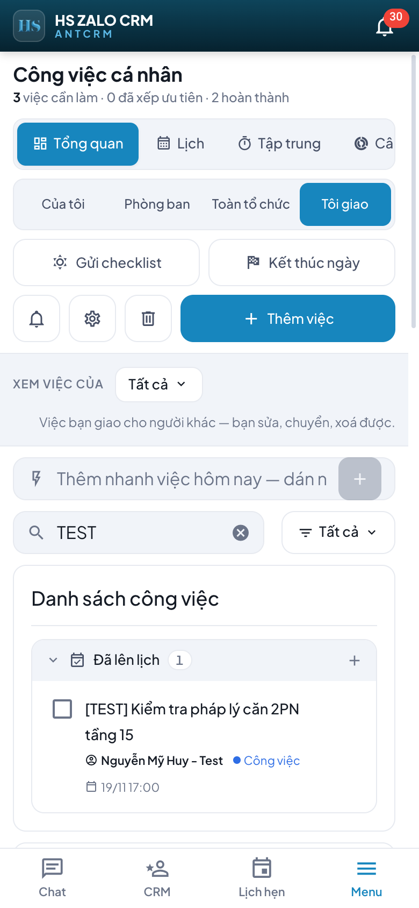

# Hướng dẫn cho CEO, chủ tổ chức

Dành cho chủ tổ chức và người có quyền quản trị. Quay lại [trang chính](README.md).

CEO làm được mọi thứ trong [bản nhân viên](01-nhan-vien.md) và [bản quản lý](02-quan-ly.md). Bản này chỉ nói phần riêng của CEO.

## Mục lục

- [Phần 1. Khác gì so với quản lý](#phần-1-khác-gì-so-với-quản-lý)
- [Phần 2. Lệnh nhanh](#phần-2-lệnh-nhanh)
- [Phần 3. Xem toàn công ty](#phần-3-xem-toàn-công-ty)
- [Phần 4. Giao việc và giao khách](#phần-4-giao-việc-và-giao-khách)
- [Phần 5. Cài đặt nhắc việc](#phần-5-cài-đặt-nhắc-việc)
- [Phần 6. Những báo cáo CEO nhận](#phần-6-những-báo-cáo-ceo-nhận)
- [Phần 7. Giới hạn hiện tại](#phần-7-giới-hạn-hiện-tại)

---

## Phần 1. Khác gì so với quản lý

| Việc | Quản lý | CEO |
|---|---|---|
| Giao việc | Người trong phòng mình và phòng con | Bất kỳ ai trong công ty |
| Xem việc | Phòng mình | Toàn công ty |
| Xoá việc người khác giao | Không | Được |
| Lệnh nhanh bắt đầu bằng `/` | Không | Được (tài khoản chủ) |
| Chỉnh cài đặt nhắc việc | Không | Được |

---

## Phần 2. Lệnh nhanh

Nhắn đúng một từ, Khởi Tâm trả ngay danh sách, không cần viết câu.

| Lệnh | Trả về |
|---|---|
| `/viec` | Việc của anh chị |
| `/viecgiao` | Việc anh chị đã giao đi, kèm người nhận và hạn |
| `/viectre` | Việc đang trễ hạn |

Lệnh nhanh chỉ tài khoản chủ dùng được. Người khác nhắn `/viec` sẽ nhận câu "Lệnh / chỉ chủ tài khoản dùng được".

---

## Phần 3. Xem toàn công ty

> Tình hình công việc của cả công ty hôm nay thế nào em?

Khởi Tâm tóm tắt: số việc xong trong ngày và ai làm, số việc trễ, số việc tồn, và các việc cần chú ý ngày mai.

Hỏi sâu hơn theo người hoặc theo phòng:

> Phòng Kinh doanh tuần này xong được bao nhiêu việc?

> Huy đang phụ trách những khách nào và tuần này có lịch hẹn gì không em?

Việc cá nhân của nhân viên không hiện, kể cả với CEO.

---

## Phần 4. Giao việc và giao khách

Cách nhắn giống bản quản lý, nhưng CEO giao được cho bất kỳ ai.

> Giao cho Huy việc: Gửi bảng tiến độ dự án cho chủ đầu tư, hạn 10h sáng thứ Ba

> Thêm khách Chị Lan số 0900000002 vào CRM và giao cho Huy phụ trách

Khởi Tâm hỏi xác nhận trước khi chuyển người phụ trách khách.

Trên Ant CRM, mục **Tôi giao** ở màn Công việc gom mọi việc anh chị đã giao.

---

## Phần 5. Cài đặt nhắc việc

Trên màn Công việc của Ant CRM có nút **bánh răng** (chỉ chủ và Admin thấy, xem ảnh trên). Ba cài đặt:

| Cài đặt | Mặc định | Ý nghĩa |
|---|---|---|
| Giờ mốc phải lên checklist | 09:00 | Sau giờ này, ai chưa xếp việc cho hôm nay thì bị nhắc |
| Trần việc tồn | 10 | Ai tồn từ ngần này việc của các ngày trước thì phải dọn bớt mới tự thêm việc mới được. Việc cấp trên giao không bị chặn |
| Ngày làm việc | Thứ 2 đến thứ 7 | Ngày nghỉ thì không nhắc lên checklist |

Chưa có lịch nghỉ lễ: ngày lễ rơi vào ngày làm việc thì Khởi Tâm vẫn nhắc.

---

## Phần 6. Những báo cáo CEO nhận

| Khi nào | Nội dung |
|---|---|
| Người nhận làm xong việc CEO giao | "X đã hoàn thành việc #…" |
| Việc CEO giao trễ quá 1 ngày | Báo một lần cho mỗi việc |
| 8:30 sáng thứ Hai | Báo cáo tuần |
| Trưởng phòng chưa nối tài khoản với Khởi Tâm | Các báo cáo lẽ ra tới trưởng phòng đó sẽ đi tiếp lên cấp trên, cuối cùng tới CEO |

CEO cũng được nhắc việc của chính mình như mọi người: chưa lên checklist, việc sắp tới hạn, việc tồn cuối ngày.

---

## Phần 7. Giới hạn hiện tại

- **Chỉ người đã nối mã nhân sự với Khởi Tâm mới được nhắc và mới nhắn Khởi Tâm làm việc được.** Nối ở Ant CRM: Cài đặt → API → khoá "GoClaw Khởi Tâm". Người chưa nối vẫn nhận được việc giao trên màn Ant CRM, nhưng Khởi Tâm không nhắn cho họ.
- **Nhân viên không giao việc cho người khác.** Chỉ trưởng phòng, phó phòng, chủ và Admin giao được.
- **Mỗi người chỉ chạy đồng hồ một việc một lúc.**
- **Khởi Tâm trả lời bằng lời của mình**, nên cùng một câu hỏi, câu chữ mỗi lần có thể khác. Con số và việc ghi vào Ant CRM thì cố định; khi cần chắc chắn, bấm link để xem trên Ant CRM.
